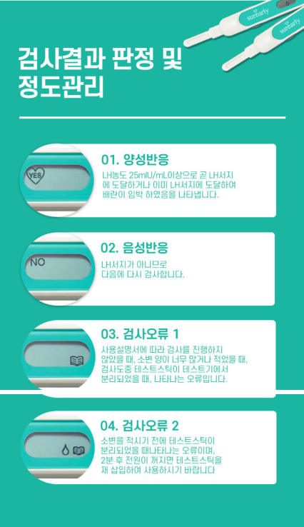
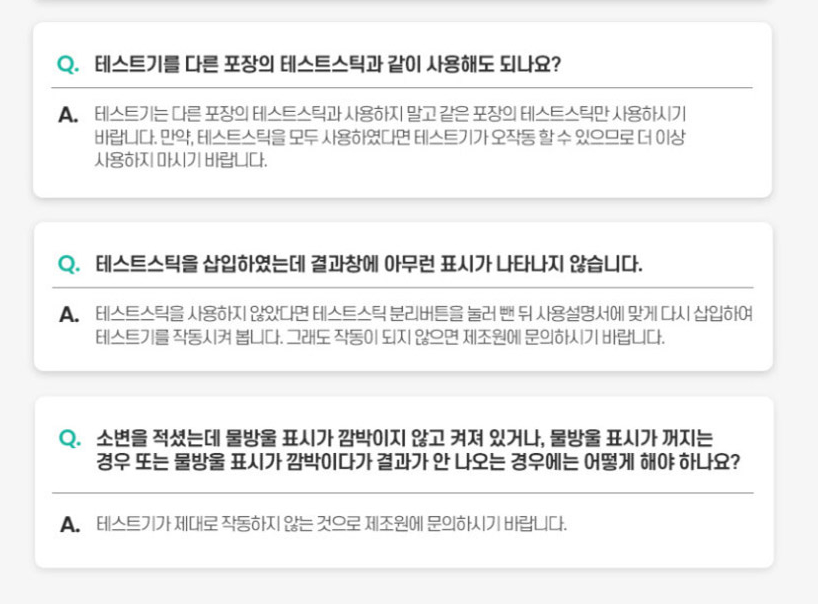
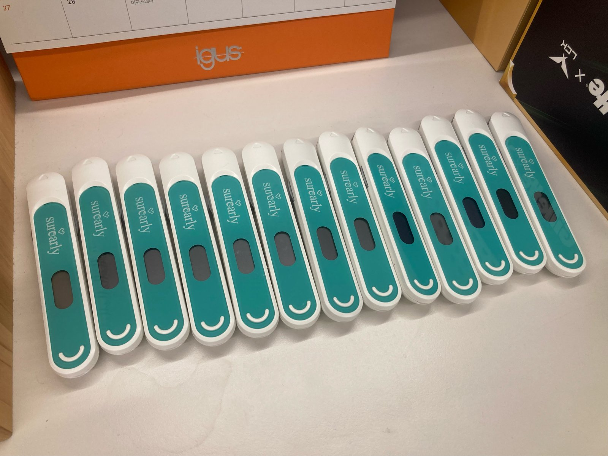

# 검사오류 원인 규명 — 회수 기기 조사

> 상태: ⬜ 진행 중
> **2026-10-08 — 조사 전제가 바뀌었다.** 구형 펌웨어는 EEPROM에 기록하지 않는다.
> 회수 기기에서 과거를 복원하는 길이 닫혔다. 아래 「구형 펌웨어」 절 참고.
> 선행: 6단계 완료 · `2026-10-02_검사오류2_부분삽입_광학값실측.md`
> 기준서: `00_v11-작업기준서.md` 0장(정정 2026-10-07) · 8장

---

## 왜 이 조사를 하나

4~6단계로 배율 방식과 EEPROM 기록 구조는 끝났으나, **검사오류 자체는 아직 해결되지 않았다.**

| 한 일 | 검사오류에 미친 영향 |
|---|---|
| 배율 튜닝 (4·5단계) | 없음. 밴드 측정·판정에만 적용. 스틱 유무 판정은 원본값을 쓴다 |
| EEPROM + UI 수정 (6단계) | 없음. 고친 것이 아니라 **셀 수 있게** 만든 것 |
| 부분 삽입 실측 (10-06) | 없음. 원인 후보 하나를 **지운** 것 |

그리고 지금까지는 전부 **책상 위 보드에서 재현을 시도**한 것이었다.
실제로 오류가 난 기기는 한 번도 읽어보지 않았다.

회수 기기 **13대**를 확보하면서 1차 자료가 생겼다. 이 조사의 목적은 하나다 —
**그 기기들의 CH3 값이 실제로 얼마인가.**

> **2026-10-08 정정** — 처음에는 EEPROM에서 과거 오류 이력을 복원할 수 있다고 보고 계획을 세웠다.
> 구형 펌웨어 소스를 열어보니 **기록 자체를 하지 않는다.** 과거 복원은 불가능하고,
> 남는 것은 **현재 상태 측정**(전압·CH3)과 **시나리오 측정**(단계별 기준값)뿐이다.

---

## 규명된 것 (2026-10-07)

### 검사오류 번호 ↔ 에러 코드 — 기준서 21행이 뒤바뀌어 있었다

사용설명서 「검사결과 판정 및 정도관리」의 아이콘 그림과 LCD 출력 함수가 켜는 아이콘을
대조해 확정했다.



| 설명서 | 아이콘 | LCD 함수 | 에러 코드 |
|---|---|---|---|
| **검사오류 1** | 책 | `DM_App_LCD_Sq_ErrStickFail_Process()` | `ERROR_STICK_FAIL` **0x02** |
| **검사오류 2** | 물방울 + 책 | `DM_App_LCD_Sq_ErrStickRemove_Process()` | `ERROR_STICK_REMOVE` **0x01** |

```c
static void DM_App_LCD_Sq_ErrStickFail_Process(void)
{
    DM_App_LCD_SetState(CH_LCD_BOOK, LCD_STATE_ON);      /* 책 하나 */
}

static void DM_App_LCD_Sq_ErrStickRemove_Process(void)
{
    DM_App_LCD_SetState(CH_LCD_BOOK, LCD_STATE_ON);      /* 책 */
    DM_App_LCD_SetState(CH_LCD_DROP, LCD_STATE_BLINK);   /* + 물방울 */
}
```

오류 화면이 둘이고 아이콘 조합도 둘이라 짝이 하나씩밖에 없다. 섞일 여지가 없다.

**교차 검증** — 설명서의 검사오류 2 설명 "**소변을 적시기 전에** 테스트스틱이 분리되었을 때…
**2분 후** 전원이 꺼지면 재삽입"은 `0x01`의 코드 주석(`Stick removed before C-Band change in
Sample Wait`) 및 `ERR_RUN_TIME`(12,000 × 10ms = 2분)과 일치한다.

### 검사오류 1 화면에는 네 가지가 모인다

`LCD_SQ_ERR_STICK_FAIL`을 넘기는 호출부를 전부 세어보면 이렇다.

| 행 | 에러 코드 | 뜻 | 설명서 문구 |
|---|---|---|---|
| 267·281·289 | `0x02` STICK_FAIL | 검사 중 스틱 분리 | "검사 중 테스트스틱이 분리" |
| 501 | `0x03` OVER_FLOW | 소변 과유입 | "소변 양이 너무 많거나" |
| 555 | `0x04` LOW_SAMPLE | 소변 부족 | "적었을 때" |
| 654 | `0x06` C_LINE_FAIL | 대조선 미형성 | **설명서에 대응 문구 없음** |

**"검사오류 1이 떴다"만으로는 원인을 가릴 수 없다.** EEPROM 에러 코드를 읽어야 넷 중 뭔지 나온다.

### 검사오류 2 화면은 하나뿐이다

```c
261행  Enter_Error(ERROR_STICK_REMOVE, LCD_SQ_ERR_STICK_REMOVE);   /* 0x01 */
275행  Enter_Error(ERROR_STICK_REMOVE, LCD_SQ_ERR_STICK_REMOVE);   /* 0x01 */
```

**`0x01` 하나뿐이다.** 원인 후보가 좁으므로 검사오류 2 건부터 파는 편이 효율적이다.

---

### 구형 펌웨어는 EEPROM에 쓰지 않는다 (2026-10-08)

회수 기기에 들어 있는 펌웨어는 `MFx_v2.1.1_alpha.2`다. 소스를 열어 확인했다.

| 있는 것 | 상태 |
|---|---|
| `BSP_EEPROM_WriteBank_0/1()` 드라이버 | 구현됨 |
| `MFO_0_Save_Parameter()` / `MFO_1_Save_Parameter()` | 구현됨 |
| 이 함수들의 **호출부** | **0군데** |

만들어만 두고 실행 경로에 연결하지 않았다. **죽은 방어 코드**다.

검사 결과와 오류는 RAM 전역에만 남는다.

```c
g_wSystem.tMFO_EEPROM_ScanData      /* RAM. 리셋되면 사라진다 */
    .wEmpty_BT / wEmpty_T / wEmpty_BC / wEmpty_C
    .wFinish_BTt / wFinish_Tt / wFinish_BCt / wFinish_Ct
    .wResult_YES_NO
    .wSystemState / wErrorState / wRunApps / wPastRunApps
    .wMainCmd / wSubCmd_1
```

**RAM도 읽지 않기로 했다.** 이유는 셋이다.

1. 마지막 1회분만 남고, 전원이 한 번이라도 끊겼으면 없다 — 회수 후 수개월 경과
2. 얻을 수 있는 `wErrorState`는 **품의서에 이미 적혀 있다**
3. 기기와 품의서가 섞여 1:1 대응이 불가능하다 — 꺼내도 "어느 사건"인지 모른다

`App_Communcation.c`에 이 값들을 UART로 내보내는 코드가 있어 리셋 없이 꺼낼 여지는 있으나,
위 세 이유로 투입 대비 회수가 맞지 않는다고 판단했다.

→ **회수 기기에서 과거를 복원할 방법은 없다.** 이것도 결론이다.

---

## 회수 기기 자료

### 품의서 (고객명은 생략)

| 품의서 | 증상 | LOT |
|---|---|---|
| 260626 | 검사오류 2 — **2회까지 전원 안 켜지다 3회차 꽂을 때 발생** | D302D50A01 |
| 260702 | 검사오류 2 — 스틱 삽입 시 나타남 | D302D50A01 |
| 260702 | 전원이 안 켜짐 (2번까진 정상 작동) | D302D90A01 |
| 260708 | 검사오류 1 — 스틱 꽂자마자 발생 | D302D50A01 |

**`D302D50A01` 세 건이 같은 로트다.** 로트 단위 공통 원인일 가능성이 있다.

### 설명서 Q&A — 두 문항이 걸린다



> **Q. 테스트스틱을 삽입하였는데 결과창에 아무런 표시가 나타나지 않습니다.**
> A. 테스트스틱을 사용하지 않았다면 테스트스틱 **분리버튼을 눌러 뺀 뒤** 사용설명서에 맞게
> 다시 삽입하여 테스트기를 작동시켜 봅니다.

**"전원이 안 켜짐"이 설명서에 공식 문항으로 들어가 있고, 대처법이 "빼서 다시 꽂기"다.**
품의서 260626의 "2회까지 전원 안 켜지다 3회차에 오류"와 정확히 맞물린다.
고객이 이 안내대로 두 번 다시 꽂았고 세 번째에 오류가 떴다는 얘기가 된다.

→ **양산 전부터 알려진 현상일 가능성.** 설명서에 적혀 있다는 것은 "가끔 그런다"를 전제로
문서를 썼다는 뜻이다.

> **Q. 테스트기를 다른 포장의 테스트스틱과 같이 사용해도 되나요?**
> A. … 테스트스틱을 **모두 사용하였다면 테스트기가 오작동** 할 수 있으므로 더 이상 사용하지
> 마시기 바랍니다.

`ERROR_OVER_USED`(0x05)와 `_nSCAN_MAX_CNT`(현재 **30**)가 이 문장의 근거다.
회수 기기의 Insert Count가 30에 가까우면 **"고장난 기기"가 아니라 "다 쓴 기기"**다.

---

## 코드 쪽 사실 (이전까지 확인분)

### 스틱 유무 판정에는 배율이 닿지 않는다

```c
uint8_t DM_App_Optic_Check_StickPresent(void)
{
    uint16_t wADC = DM_App_Optic_Measure(OPTIC_CH_3);      /* Cal_Ratio 없음 */
    return (wADC < OPTIC_STICK_REMOVE_THRESHOLD) ? 0 : 1;  /* 2600 */
}
```

배율은 `STICK_INSERT`에서 **1회** 계산되고 이후 고정이며, 밴드 측정·판정 9곳에만 쓰인다.

### "전원 안 켜짐"과 "검사오류"는 같은 뿌리다

IDLE 핸들러에서 `Check_StickPresent()`가 0을 돌려주면 `else`로 빠져 **아무것도 하지 않고
다시 잔다.** 사용자 눈에는 "전원이 안 켜짐"이다.

| 꽂은 회차 | CH3 | 코드가 가는 길 | 사용자가 보는 것 |
|---|---|---|---|
| 1·2회 | 2,600 미만 | `else` → 다시 잠 | **전원이 안 켜짐** |
| 3회 | 2,600 이상 (간신히) | 검사 시작 → 이후 단계에서 걸림 | **검사오류** |

**같은 증상이 문턱값 위냐 아래냐로 갈린다.**

### 기준 보드 실측값 (2026-10-06, 동일 스틱 10회)

> **양품이 아니다.** 보유한 기기 14대가 전부 생산 반송품이라 정상 기기를 만져본 적이 없다.
> 아래 값은 "정상 기준"이 아니라 **고정된 비교 대상**으로만 쓴다.
> 기기 간 상대 비교와 같은 기기의 조건별 비교에는 유효하고,
> "이 값이 양품 수준인가"에는 답하지 못한다. 양품 기기 확보 필요.

| 상태 | 평균 | 범위 |
|---|---|---|
| 정상 삽입 | 3,368 | 3,320~3,485 |
| 버튼 한 번 밀림 | 3,618 | 3,524~3,655 |
| 플라스틱만 | 701 | 674~746 |
| 스틱 없음 | 1,217 | — |
| 코인셀 방전 시 | 434 | (09-30 실측) |

기준 보드는 문턱값 2,600까지 **720 이상** 여유가 있다. 회수 기기도 그런지가 이 조사의 핵심이다.

---

## 조사 계획 (2026-10-08 개정)



**기기마다 번호를 붙이고 기록한다.** 13대가 섞이면 되돌릴 수 없다. (라벨 부착 완료)

### 두 덩어리

| | 하는 일 | 알고자 하는 것 |
|---|---|---|
| **A** | 시나리오 측정 — `설계문서/인수인계/systemFlowChart.html`의 6단계를 실제로 한 바퀴 | 검사 전 과정에서 **단계별로 어떤 값이 나오는가** |
| **B** | 기기별 현재 상태 — 전압 + CH3 | 회수 기기들이 **지금** 어떤 상태인가 (분포) |

A는 기준 보드로 먼저 한 바퀴 돌려 기준표를 만든다. B의 숫자를 해석할 비교 대상이 된다.

### B 기기당 순서

```
① 코인셀 전압 측정
② CH3 측정 — 디버거 + g_DbgStickADC
   (선택) PROGRAM MEMORY Checksum — 구/신 펌웨어 판별용
```

### 폐기된 항목 (2026-10-08)

| 항목 | 폐기 사유 |
|---|---|
| ~~EEPROM 읽기로 과거 오류 복원~~ | 구형 펌웨어가 기록하지 않음 |
| ~~검사 후 EEPROM 재읽기로 대조~~ | 같은 이유 |
| ~~RAM에서 `wErrorState` 추출~~ | 잔존 가능성 낮음 · 품의서에 이미 있음 · 기기-품의서 대응 불가 |

### 추가로 볼 것

- **한두 대는 스틱을 들어올리거나 기울여서도 CH3 측정** — 상급자의 유격 가설 검증.
  10-06 실측은 **길이 방향(버튼으로 밀림)**만 봤고, 높이·기울어짐은 안 봤다
- **양품 기기 확보 요청** — 기준 보드가 반송품이라 절대 판정이 불가능하다

### STVP로 EEPROM 읽는 법 (2026-10-06 확립 · 참고용으로 남김)

과거 복원 목적은 폐기됐으나, **PROGRAM MEMORY Checksum으로 펌웨어 버전을 가르는 데**는 쓸 수 있다.

| 설정 | 값 |
|---|---|
| Hardware | `ST-LINK` |
| Port | `USB` |
| Programming mode | `SWIM` |
| Device | `STM8L151x3` |

**Read → Current Tab**. **`Program`·`Erase`는 절대 누르지 않는다.**
STVP와 IAR은 ST-LINK를 동시에 잡지 못한다. 한쪽을 완전히 종료하고 다른 쪽을 연다.

| EEPROM offset | 실제 주소 | 내용 (신형 펌웨어 기준) |
|---|---|---|
| 0 | 0x001000 | Insert Count |
| 1 | 0x001001 | Test Complete Count |
| 2 | 0x001002 | Error Step |
| 3 | 0x001003 | Error Code |
| 4~19 | 0x001004~13 | 삽입 시 초기 광학값 4채널 |
| 20~243 | 0x001014~ | 레코드 7칸 × 32바이트 |

---

## 레코드 구조 — 코드로 확정 (2026-10-07)

`DM_App_Main_Sq_Save_Result_To_Rom()` + `DM_App_Rom_Save_CurrentResult()`를 읽어 확정했다.
EEPROM 덤프를 추정 없이 해석할 수 있다.

### 위치

```c
#define ROM_OFFS_RESULT_DATA   20   /* 7 Channels * 32 Bytes = 224 Bytes */
#define RESULT_DATA_SIZE       32   /* 16 shorts */

wAddr = ROM_OFFS_RESULT_DATA + (bIndex % 7) * RESULT_DATA_SIZE;
```

| 칸 | offset | 주소 |
|---|---|---|
| 0 | 20 | `0x1014` |
| 1 | 52 | `0x1034` |
| 2 | 84 | `0x1054` |
| 3 | 116 | `0x1074` |
| 4 | 148 | `0x1094` |
| 5 | 180 | `0x10B4` |
| 6 | 212 | `0x10D4` |

### 한 칸(32바이트) 안의 순서

`uint16_t awRomBuffer[16]` — 2바이트 16개. 상위 바이트가 앞(big-endian).

| 워드 | 내용 |
|---|---|
| 0~3 | 배율 (CH0~CH3) |
| 4~7 | `gs_awEmptyBand_LowData` — 빈 밴드 |
| 8~11 | `gs_awResultBand_LowData` — 결과 밴드 |
| 12~14 | `gs_awResult` — 판정 |
| 15 | `(ErrorStep << 8) | ErrorCode` |

**바이트 순서 증명** — 워드 15는 코드가 Step을 상위로 올려 만든다. 1번 기기 덤프에서
Step 2 / Code 1이 `02 01`로 나타났다. 앞 바이트가 상위임이 코드와 덤프로 직접 확인된다.

**결과 밴드가 0이면 시료 도착 전에 끝난 것이다.** 0은 빈 값이 아니라 "여기까지 왔다"는 표시다.

---

## 측정 결과 — B (기기별 현재 상태)

| 기기 | 전압 | CH3 | 기준 보드와의 차 | 비고 |
|---|---|---|---|---|
| 1 | — | — | | **데이터 무효 — 개발 보드로 추정, 아래 참고** |
| 2 | | | | |
| 3 | | | | |
| 4 | | | | |
| 5 | | | | |
| 6 | | | | |
| 7 | | | | |
| 8 | | | | |
| 9 | | | | |
| 10 | | | | |
| 11 | | | | |
| 12 | | | | |
| 13 | | | | |

기준 보드 CH3 = 3,368 (2026-10-06, 10회 평균).

## 측정 결과 — A (시나리오 단계별)

별도 문서로 분리했다 → **`2026-10-08_시나리오_단계별_측정.md`**

상급자 지시로 시작된 별개 과업이고, 원인 규명이 끝난 뒤에도 계속 쓰는 기준표라
여기서 닫히지 않게 떼어냈다.

---

## 1번 라벨 기기 — 개발 보드로 추정 (데이터 무효)

2026-10-07에 1번 기기로 읽은 EEPROM은 **회수 기기 자료가 아니다.** 근거는 셋이다.

1. 읽힌 레코드가 **6단계에서 새로 만든 구조와 정확히 일치**한다 (배율 4워드 → 빈 밴드 4워드 →
   `(Step<<8)|Code`). 구형 펌웨어에는 이 구조가 없다.
2. 구형 펌웨어는 EEPROM에 쓰지 않는다 (위 절).
3. Insert 33 / Complete 0 — 스틱만 반복해 꽂고 소변은 한 번도 쓰지 않은 기록.
   디버깅 흔적과 맞는다.

→ **라벨 작업 중 책상 보드가 13대 사이에 섞여 들어간 것**으로 본다.

### 당시 읽은 값 (참고용으로만 보존)

offset 0~3 = Insert **33** / Complete **0** / Step **1** / Code **0x01**
초기 광학값 = **3621 / 3553 / 3552 / 3642**
전압 **2.73V** · CH3 **3,146**

| 칸 | 배율 | 빈 밴드 | 결과 밴드 | Step | Code |
|---|---|---|---|---|---|
| 0 | 33 33 33 33 | 1200 1187 1187 1189 | 0 | 2 | 01 |
| 1 | 33 33 33 36 | 1199 1190 1188 1207 | 0 | 2 | 01 |
| 2 | 32 32 32 32 | 1193 1187 1185 1182 | 0 | 0 | 00 |
| 3 | 0 | 0 | 0 | 1 | 01 |
| 4 | 0 | 0 | 0 | 1 | 01 |
| 5 | 33 33 33 33 | 1206 1196 1196 1205 | 0 | 2 | 01 |
| 6 | 33 33 33 33 | 1198 1183 1182 1195 | 0 | 1 | 01 |

**쓸모가 남은 부분** — 배율 33이 `1200 × 100 ÷ 3621 = 33`과 일치한다. 배율 계산이
실기기에서 설계대로 동작함을 확인한 셈이다. 레코드 구조 해석이 맞다는 검증도 된다.

**남은 의문 (개발 보드 기준이라 우선순위 낮음)**
- 칸 3·4는 배율까지 0 — 배율 계산 전에 터진 것으로 보이나 미확인
- 칸 2는 Code `0x00`인데 결과 밴드도 0 — 저장 경로 미확인
- Step이 1과 2로 갈림 — `LCD_SQ_ERR_*` 열거형 값 확인 필요

---

## 기 측정 2대 (2026-10-06, 번호 미부여)

| | PROGRAM Checksum | DATA Checksum | 전압 |
|---|---|---|---|
| A | DFA77 | **0** | 2.89V |
| B | DFAB5 | **0** | — |

당시 "구 펌웨어가 EEPROM을 쓰지 않을 가능성"으로 남겨둔 추측이 **2026-10-08에 코드로 확정됐다.**
DATA Checksum 0은 고장이 아니라 **정상 동작**이다.

PROGRAM Checksum이 서로 다르다 — 회수 기기 사이에도 펌웨어 버전이 섞여 있다.

---

## 특이사항

기기별로 눈에 걸린 것만 모은다. 같은 항목이 여러 대에서 반복되면 그때 패턴으로 올린다.

(측정 중 채움)

---

## 그래서 무엇을 할 것인가

1. **시나리오 측정 (A)** — 기준 보드로 6단계 한 바퀴. 단계별 기준표를 만든다.
   먼저 코드에서 측정 지점(변수·행 번호)을 정하고, 디버거 정지 중 타이머가 같이 서는지 확인한다.
2. **기기 2~13 (B)** — 전압 + CH3. 분포를 본다.
3. **양품 기기 요청** — 현재 보유 14대가 전부 반송품이라 절대 판정이 불가능하다.
4. 여유되면 회수 기기 몇 대에도 시나리오 측정.

**이번 조사로는 "왜 그 고객 기기에서 오류가 났나"에 답하지 못한다.** 과거가 남아 있지 않다.
답할 수 있는 것은 **"이 기기들이 지금 문턱값에 얼마나 가까운가"**이고,
여러 대가 2,600 근처에 몰려 있다면 그것이 여유(margin) 부족의 증거가 된다.

---

## 걸린 것 · 남은 것

- **임시 디버그 코드 `g_DbgStickADC`는 조사가 끝난 뒤 삭제한다.**
  (`DM_Optic_Handle_App.c` 전역 선언 1줄 + 대입 1줄)
- 기준서 8장 `OPTIC_STICK_REMOVE_THRESHOLD`에 배율 적용 여부는 이 조사 결과를 보고 판단한다
- 기준서 2장 "진행 중: 7단계" — 7단계는 10-02에 취소됐으나 아직 갱신 안 됨
- `_nSCAN_MAX_CNT`(30)와 제품 20T 불일치 — 미확인
- 1번 라벨 기기가 개발 보드인지 확증하지 못했다. 10-07에 신형 펌웨어를 구워버려
  PROGRAM Checksum 대조가 불가능해졌다. 정황 증거만 있다

---

## 오늘의 교훈

(작업 중 채움)
